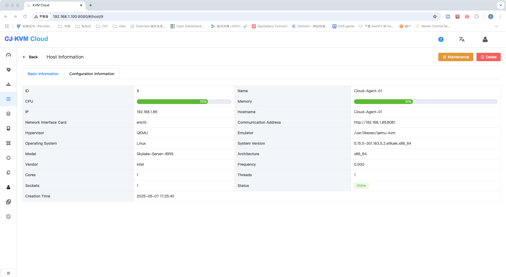
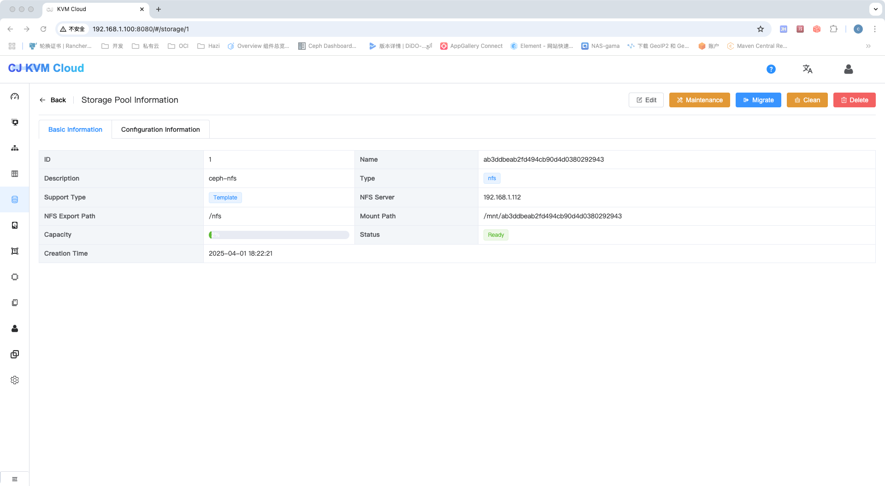
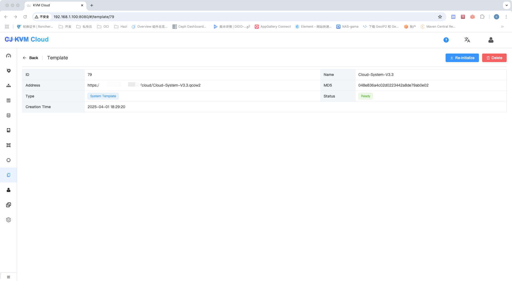
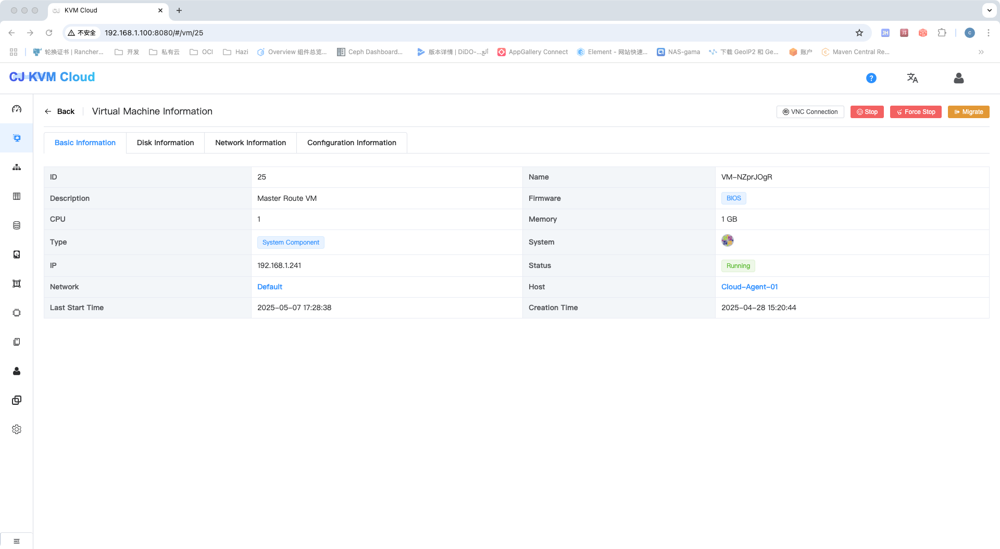

English | [中文](README.md)
### Project Introduction
KVM Cloud is a lightweight private cloud platform implemented in Java. It is designed to help small and medium-sized enterprises quickly manage computing, storage, network, and other resources, enabling them to build their own cloud platforms. Its features include, but are not limited to:
- Basic KVM-based VM functions (create, start, stop, reinstall, webVNC, etc.)
- Support for NFS, GlusterFS, and Ceph RBD disk storage pools
- Support for dynamic disk attachment and detachment
- Multi-host management
- Template management for rapid VM creation
- Automatic VM IP address management
- Multiple NIC support
- Support for cloud-init initialization
- Support for internal DNS resolution
- Support for NAT forwarding
- Support for key management and login
- Support for hostname customization

## 📌 Commercially Licensed Edition (Ruiyun kvm-cloud)
> This repository serves as the open-source baseline. A separate commercially licensed enhanced edition is also available:
> - Open-source edition: Licensed under the repository's original open-source license and intended for learning and evaluation only, with no commercial SLA or value-added components.
> - Commercially licensed edition: Ruiyun kvm-cloud provides enterprise enhancements such as multi-cluster management, PCI passthrough, SDN networking, offline licensing, overlay images, monitoring, and disk snapshots. **The commercial edition's source code is not included in this repository and is not covered by this repository's open-source license. A separate commercial license is required for use.**
>
> For the Ruiyun commercially licensed edition, please contact official customer service through [Contact Us](https://www.ruiyuncloud.cn/#contact) or visit the [official website](https://www.ruiyuncloud.cn/) for details.

## Version Comparison
| Feature | Open-source Edition | Subscription Edition | Description |
| --- | --- | --- | --- |
| Multi-cluster management | ❌ | ✅ |  |
| PCI passthrough | ❌ | ✅ | The subscription edition supports PCI passthrough for VMs bound to a host. |
| Networking | FLAT, VLAN | FLAT, VLAN, VXLAN | The subscription edition provides SDN management services and supports VXLAN networks. |
| Security groups | ❌ | ✅ | The subscription edition generates dynamic security group flows based on the OpenFlow 1.3 protocol. |
| Cluster features | ❌ | ✅ |  |
| Storage pools | Ceph RBD/NFS/GlusterFS/Local | Ceph RBD/CephFS/NFS/GlusterFS/Local |  |
| Overlay disks | ❌ | ✅ | The subscription edition supports overlay disks to save disk space. |
| Monitoring | ❌ | ✅ | The subscription edition supports VMs, hosts, and other resources. It requires Prometheus and provides visualization pages for basic memory, disk, and other metrics. |
| Disk snapshots | ❌ | ✅ | The subscription edition supports VM disk snapshots, automatic on-demand template downloads, automatic storage pool synchronization, and other features. |
| API documentation | ❌ | ✅ | The subscription edition integrates API documentation. |
| AppKey access | ❌ | ✅ | The subscription edition provides API key access for secondary integration. |
| Bridge type | Linux Bridge, OVS Bridge | OVS Bridge |  |
| Fault domains | ❌ | ✅ | The subscription edition provides host isolation configuration, with VMs belonging to their respective fault domains. |
| Template and disk upload | ❌ | ✅ |  |
| Batch operations | Partially supported | ✅ | Supports batch creation, startup, shutdown, and other operations. |
| Audit logs | ❌ | ✅ |  |

### Operating System
Linux (currently only the x86_64 architecture is supported)

### Repository Hosting
[AtomGit](https://gitcode.com/cj520120/kvm-cloud) <br/>
[Gitee](https://gitee.com/cj520120/kvm-cloud) <br/>
[GitHub](https://github.com/cj520120/kvm-cloud) <br/>
If this project is helpful to you, please star and fork it. Your star is the greatest support for us.

### Configuration Notes
This document provides configuration instructions for CentOS 7 only. For Ubuntu, refer to [Ubuntu_README.md](Ubuntu_README.md). For other operating systems, please consult the relevant documentation.

### SELinux Configuration
```sh
setenforce 0
vi /etc/selinux/config
SELINUX=permissive
```

### Sysctl Configuration
```sh
vim /etc/sysctl.conf
net.ipv4.ip_forward=1               # Enable forwarding and save
sysctl -p
```

### Firewall Configuration
```sh
systemctl stop firewalld
systemctl disable firewalld
systemctl stop iptables
systemctl disable iptables
systemctl stop NetworkManager
systemctl disable NetworkManager
```

### NFS Configuration
#### 1. Install NFS Packages
```sh
yum -y install nfs-utils rpcbind
```

#### 2. Enable Services at Boot and Start Them
```sh
systemctl enable rpcbind
systemctl enable nfs-server
systemctl start rpcbind
systemctl start nfs-server
```

#### 3. Create a Storage Directory
```sh
mkdir -p /data/nfs
```

#### 4. Edit the Configuration
```sh
vi /etc/exports
/data/nfs *(rw,sync,no_root_squash)
```

#### 5. Reload the exportfs File
```sh
exportfs -a
```

#### 6. Restart the Services
```sh
systemctl restart rpcbind
systemctl restart nfs-server
```

#### 7. Test Whether Mounting Works
```sh
mount -t nfs 127.0.0.1:/data/nfs /mnt
df -h        ### The mount is successful if it appears in the output
umount /mnt
```

### KVM
#### 1. Verify That the Host Supports Virtualization
```sh
lsmod | grep kvm # Check the output to confirm whether virtualization is supported
If the host is a VMware virtual machine, enable virtualization in the VM settings.
```

#### 2. Install KVM on the Host
```sh
yum install qemu-kvm libvirt bridge-utils
yum install java-1.8.0-openjdk* -y
```

#### 3. Configure a Network Bridge on the KVM Host
**Important:** Use `ip addr` to check your `network interface name`. In CentOS 7, the interface name may not be `eth0`. An incorrect interface name will prevent the VMs configured later from being accessed properly.

After confirming the correct interface name, configure the bridge:

1) Create the bridge interface file `/etc/sysconfig/network-scripts/ifcfg-br0`.
```sh
DEVICE=br0
TYPE=Bridge
ONBOOT=yes
BOOTPROTO=static
IPADDR=192.168.2.130
NATMASK=255.255.255.0
PREFIX=24
GATEWAY=192.168.2.1
DNS1=8.8.4.4
DNS2=8.8.8.8
```

2) Modify the default network interface configuration.

> **Change the filename to match the actual interface name. For example, if the interface is eth0, the corresponding file is `/etc/sysconfig/network-scripts/ifcfg-eth0`.**
```sh
BOOTPROTO=none
NAME=eth0
DEVICE=eth0
ONBOOT=yes
NM_CONTRLLED=no
BRIDGE=br0
```

3) For OVS configuration, refer to [ovs-bridge-sample.md](scripts/ovs-bridge-sample.md).

#### 4. VNC Configuration
```sh
vi /etc/libvirt/qemu.conf
vnc_listen="0.0.0.0"
user = "root"
group = "root"
```

#### 5. Libvirtd Configuration
1) Modify the libvirtd configuration.
```sh
vi /etc/libvirt/libvirtd.conf
listen_tls = 0
listen_tcp = 1
unix_sock_group = "root"
unix_sock_rw_perms = "0777"
auth_unix_ro = "none"
auth_unix_rw = "none"
tcp_port = "16509"
listen_addr = "0.0.0.0"
auth_tcp = "none"

vi /etc/sysconfig/libvirtd
LIBVIRTD_ARGS="--listen"
systemctl restart libvirtd
```

#### Project Compilation
```sh
mvn clean package -Dfile.encoding=UTF-8 -DskipTests=true
```

### Completing the Configuration
1. Import the MySQL tables and related data.
> **The scripts are located in the `scripts` directory.**

2. Modify the configuration files.

3. Start the management and agent services separately, then open http://localhost:8080/ in a browser.
```sh
Management: java -jar cloud-management-1.0-SNAPSHOT.jar --spring.config.location=server.yaml
Agent: java -jar cloud-agent-1.0-SNAPSHOT.jar --spring.config.location=client.properties
--spring.config.location is optional and specifies the configuration file. It can be omitted if no changes are needed. The configuration files are application.properties in the src/main/resources directory of each module.
```

4. The default platform login username/password is admin/123456.

5. Create a basic network.

> **Use bridged networking. The IP address range must be in the same subnet as the host. You can isolate the range between the start and end IP addresses from the host network to prevent IP conflicts. VLAN is only supported with OVS.**


6. Create a host.



7. Create a storage pool.
> Templates can only use shared storage pools.



8. Download a base template.
```sh
Use an official Red Hat-based image with iptables support. For example:
> https://yum.oracle.com/templates/OracleLinux/OL10/u1/x86_64/OL10U1_x86_64-kvm-b270.qcow2

Do not use Chinese Linux distribution images. Chinese distributions vary in their support for cloud-init, which may cause system initialization to fail. If you need to use one, test its compatibility yourself.

Alternative download (if the official link is unavailable)
Template path: cloud/v5/OL10U1_x86_64-kvm-b270.qcow2
Baidu Netdisk: https://pan.baidu.com/s/1bOAeuvFj8hG4skDaoZnYtQ?pwd=1bpn Access code: 1bpn

Notes
1. The system template downloads and installs packages over the network during initialization, so ensure that the network is properly configured.
2. Initialization time depends on network speed. You can use the virsh console command to log in to the system and check the initialization status.

Default template credentials
Default username: kvm-user
Default password: Kvm@123456
```

9. Configure the system template.



10. Wait for the system template to finish downloading and the system VM to initialize successfully.

11. When attaching additional disks to Windows, install the virtio-win.iso driver.

12. Create a VM.




### Related Issues

1. Configuration file not found, causing database connection problems
```sh
server.yaml and client.properties correspond to application.yaml and application.properties in the management and agent projects, respectively. Rename the files and modify the relevant configuration as needed before running.
```

2. Backup and recovery
```sh
Perform full backups of the database and storage pools.
Data is invaluable. It is recommended that you back up the data in your virtual machines.
```

3. Network isolation
```sh
Currently, VLAN mode is only supported with OVS bridges. If needed, install OVS yourself.
```

4. Some Windows systems cannot find a boot device
```sh
1. First, confirm that the ISO system type selected during creation is correct.
2. If the system type is correct, use a tool such as LaoMaoTao to create a PE ISO image and use it when creating the system. After entering the PE system, unmount the disc on the page and mount the ISO of the operating system you want to install. You can then install the operating system normally through PE.
```

5. Windows systems do not recognize disks
```sh
1. Windows does not include virtio drivers. Install the virtio-win.iso driver.
2. If the affected disk is the system disk, temporarily mount the virtio-win.iso driver on the disk selection page during installation, or select the IDE bus.
```

6. Recovery after a server power failure and restart
```sh
A power failure may corrupt virtual disks. If a VM cannot start, use qemu-img check to inspect the disk and perform the appropriate repairs.
```

7. Nested virtualization for virtual machines

- Verify whether nested virtualization is enabled on the KVM host:
```sh
For Intel processors, run: cat /sys/module/kvm_intel/parameters/nested
For AMD processors, run: cat /sys/module/kvm_amd/parameters/nested
An output of N or 0 means nested virtualization is disabled. An output of Y or 1 means nested virtualization is enabled on the host.
```

- To enable nested virtualization, create a file named `/etc/modprobe.d/kvm-nested.conf` with the following contents:
```sh
options kvm-intel nested=1
options kvm-intel enable_shadow_vmcs=1
options kvm-intel enable_apicv=1
options kvm-intel ept=1
```

- Reboot the host.
- Verify that nested virtualization is now enabled.
```sh
cat /sys/module/kvm_intel/parameters/nested
```

8. cloud-init configuration
- cloud-init uses the NoCloud data source. Modify the cloud configuration as follows:
```yaml
datasource:
  NoCloud:
    seedfrom: http://169.254.169.254/
datasource_list: [  NoCloud ]
```
- The user template must have qemu-guest-agent installed and guest-exec enabled; otherwise, startup initialization cannot be configured.

9. After deleting a host from the page, if you need to add it again, delete `config.json` from the Agent directory on that host and restart the Agent.

10. For signature errors, ensure that the system time is synchronized between the management and agent services.

11. Modify the default machine settings
```sh
Adjust the system configuration properties vm.machine.name and vm.machine.arch.
The supported values depend on the operating system. Use the following commands to query them:
CentOS: /usr/libexec/qemu-kvm -machine help
Ubuntu: qemu-system-i386 -machine help
```

12. UEFI support
```sh
Adjust the system configuration properties vm.uefi.loader.path, vm.uefi.loader.vargs.template.path, and vm.uefi.loader.vargs.base.path.
```

13. Network connectivity problems
```sh
Use a clean operating system installation whenever possible. If the network is unavailable, check the firewall, iptables, and other related settings.
```

14. VMs fail to start on Ubuntu
```sh
Ubuntu reports: qemu-system-x86_64: unable to map backing store for guest RAM: Cannot allocate memory
Disable huge page caching by modifying vm.memory.huge.pages.enable and vm.memory.huge.pages.size, or append vm.nr_hugepages=10240 to /etc/sysctl.conf. Adjust the value according to your actual requirements.
```
